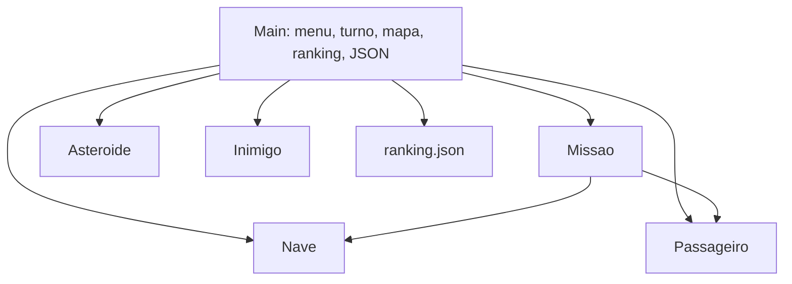
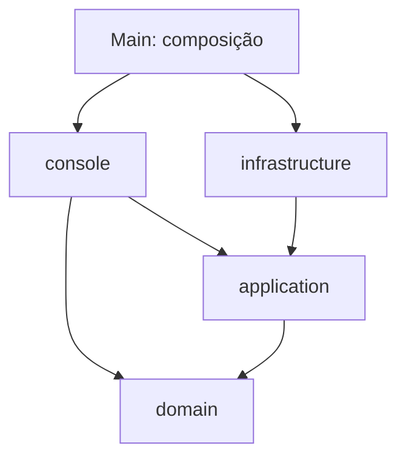
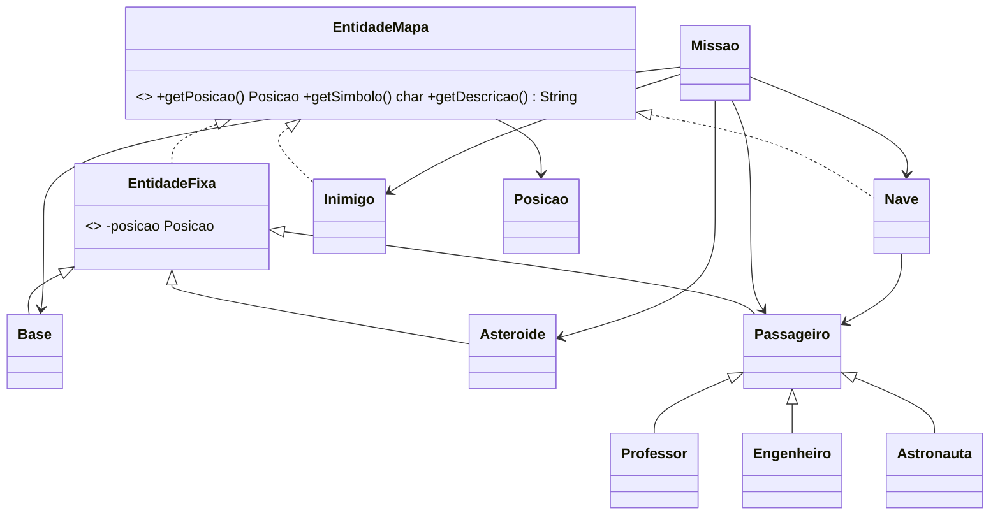

# Fase 1 — Refatoração do Missão Marte (SOLID, GRASP e padrões)

## 1. Migração e problemas do original

**Entrada:** dez arquivos Java da versão POO, preservados em `../fase-00-oopuro/src`. A refatoração foi produzida separadamente.

O `Main.java` original tinha cerca de 570 linhas, acumulando menu e entrada (`main`, `lerLinha`, `lerDificuldade`, `lerTamanhoMapa`), turno e pontuação (`jogarPartida`), construção da missão (`criarNovaMissao`, `criarPassageiroPolimorfico`, `posicaoOcupada`), desenho (`desenharMapa`) e persistência (`loadRanking`, `saveRanking`, `parseRankingJson`). Essas responsabilidades acoplavam regras a `Scanner`, `System.out` e `Files` e impediam testar turnos sem executar o terminal.

### Passos da refatoração

1. Copiados os originais sem modificar o código da Fase 0.
2. Criado `domain` com estado, posição, passageiros, nave e perigos.
3. Isolada a construção do cenário em `application.CriadorMissao`.
4. Criados `Comando`, `Partida` e `ResultadoTurno`: comandos chegam ao domínio da partida já convertidos, sem `Scanner`.
5. Criado `console.ConsoleApp` para menu e entrada, e `console.MapaRenderer` para desenho.
6. Criados `application.RankingRepository` e `RankingService`, com a implementação `infrastructure.ArquivoRankingRepository`.
7. Adicionados script PowerShell, testes de regressão e documentação.

### Responsabilidade → antes → depois

| Responsabilidade | Antes | Depois |
|---|---|---|
| Montagem inicial | `Main.main` | `Main.main` (apenas composição) |
| Menu e leitura | `Main.main`, `lerLinha` | `ConsoleApp.executar`, `ler` |
| Rodada, score, vitória, derrota | `Main.jogarPartida` | `Partida.executar` |
| Geração do mapa | `Main.criarNovaMissao` | `CriadorMissao.criar` |
| Resgate, entrega, colisão | `Missao` e `Main` | `Missao.embarcar`, `desembarcarNaBase`, `verificaColisao` |
| Desenho e legenda | `Main.desenharMapa` | `MapaRenderer.desenhar` |
| Ranking Top 5 | `Main.isTopScore` e chamadas | `RankingService.registrarVitoria` |
| Armazenamento JSON | `Main.loadRanking/saveRanking` | `ArquivoRankingRepository.listar/salvar` |

### Inconsistências e ajustes de regra

- **Desembarque:** o original encerrava ao retornar à base com todos a bordo, sem liberar a capacidade. Agora `Missao.desembarcarNaBase()` transfere passageiros para o contador `entregues`; `Missao.venceu()` exige que todos estejam **entregues**.
- **Indicadores:** sempre deve valer `a bordo + entregues + restantes = total`. `Missao.indicadoresConsistentes()` permite validar isso.
- **Posições iniciais:** o gerador reserva (0,0) para a **base e a nave**, que necessariamente começam sobrepostas (exceção intencional ao requisito literal de não sobreposição). Nenhum passageiro, asteroide ou inimigo nasce nessa célula ou na mesma célula que outro elemento.
- **Capacidade:** mantida em 5; atende aos 4/5/5 passageiros de fácil/médio/difícil. Múltiplas viagens à base são suportadas.
- **Colisão:** o original descontava uma vida; agora desconta uma vida **e 5 pontos** além do custo de movimento, para atender ao roteiro de teste solicitado. Alteração deliberada.
- **Tamanho do mapa:** entrada menor que 2 é normalizada para 2, evitando loops inviáveis para cenários cheios; maior que 100 é limitada a 100 para evitar saída excessiva.
- **Ranking:** preservado Top 5 em `ranking.json`; mantém campos `name`, `score`, `dificuldade`, `passageirosColetados`, `dataHora`, `tempoJogo`. O campo de passageiros passa a significar **entregues**; nomes externos e formatação foram mantidos para compatibilidade básica.
- **Movimento:** preservada a convenção `w` reduz Y e `s` aumenta Y. Pontuação inicial preservada: 30/20/45.
- **Legenda:** agora é derivada dos símbolos e descrições informados pelas entidades. O símbolo `@` da nave substitui `L` no mapa enquanto ela ocupa a base.

## 2. SOLID (com limites reais)

| Princípio | Classes/métodos | Como foi aplicado | Limite existente |
|---|---|---|---|
| SRP | `MapaRenderer.desenhar`, `CriadorMissao.criar`, `ArquivoRankingRepository.salvar` | Cada classe recebe um eixo principal de responsabilidade | `ConsoleApp` ainda junta menu e execução interativa |
| OCP | `Passageiro.getPontuacao`, subclasses | A pontuação é obtida polimorficamente sem condicionar a classe do passageiro | `CriadorMissao.criar` ainda contém `switch` para instanciar subclasses |
| LSP | `Professor`, `Engenheiro`, `Astronauta` | Qualquer subtipo pode ser tratado como `Passageiro` em `Missao.embarcar` e `Partida.executar` | A implementação não possui testes de contratos genéricos para novos subtipos |
| ISP | `EntidadeMapa`, `RankingRepository` | Contratos reduzidos a posição/símbolo/descrição e a operações de ranking | `RankingRepository` ainda combina leitura e escrita no mesmo contrato |
| DIP | `RankingService(RankingRepository)` | A aplicação depende da abstração; implementação do arquivo é escolhida por `Main` | `ConsoleApp` conhece a classe concreta `MapaRenderer`; não usa interface de visualização |

## 3. GRASP — padrões identificados na nova versão

| Padrão | Classe e método | Justificativa da responsabilidade |
|---|---|---|
| Information Expert | `Missao.desembarcarNaBase`, `Nave.desembarcar` | Missão conhece o destino dos passageiros; Nave conhece sua lista a bordo |
| Creator | `CriadorMissao.criar` | Um criador concentra a construção e a validação do conjunto de elementos |
| Controller | `Partida.executar` | Entrada `Comando` é convertida em uma transição de jogo sem conhecer console |
| Low Coupling | `RankingService.registrarVitoria` | Depende de `RankingRepository`, não de arquivo ou biblioteca JSON |
| High Cohesion | `MapaRenderer.desenhar` | Formatação textual está concentrada no apresentador, não nas regras |
| Polymorphism | `Passageiro.getPontuacao`, `getSimbolo`; `Professor`, `Engenheiro`, `Astronauta` | Subtipos fornecem dados próprios sem verificação de `instanceof` na regra |
| Pure Fabrication | `RankingService.registrarVitoria`, `MapaRenderer.desenhar` | Classes de serviço/apresentação não representam entidades do jogo |
| Indirection | `RankingRepository.listar/salvar` | A interface medeia o uso da persistência pela aplicação |
| Protected Variations | `RankingRepository` e `ArquivoRankingRepository` | Alterações no armazenamento não precisam alterar o código da partida |

**Contagem:** 9 princípios GRASP identificáveis com evidências nesta versão; o enunciado exige pelo menos 5. Isso não implica implementação perfeita: as limitações de SOLID permanecem explícitas.

**No código POO inicial:** `Information Expert` e `Polymorphism` são claramente observáveis; `Creator` e `Controller` aparecem parcialmente no `Main`, mas com responsabilidades misturadas.

## 4. Padrões de projeto e distinção de conceitos

### Factory (criação de objetos, **Simple Factory**, não Factory Method GoF)

- **Problema:** a lógica de geração ficava misturada com o menu e execução na classe `Main`.
- **Antes:** `Main.criarNovaMissao(Random, ..., Dificuldade)` criava tudo.
- **Depois:** `CriadorMissao.criar(Dificuldade, int)` retorna `Missao` com passageiros, perigos e nave.
- **Classificação precisa:** Simple Factory/serviço de fabricação; **não** é Factory Method GoF. O `switch` que escolhe subtipo de passageiro **não** é Strategy.

### Repository

- **Problema:** persistência em arquivo dentro de `Main`.
- **Antes:** `Main.loadRanking`, `Main.saveRanking`.
- **Depois:** `RankingRepository` define contrato, `ArquivoRankingRepository` implementa JSON, `RankingService` aplica regra Top 5.
- **Classificação precisa:** padrão Repository no sentido de porta/adapter de persistência, com inversão de dependência.

### Value Object

- `Posicao` é um `record` imutável, com igualdade pelo valor de X e Y e método `deslocar` que cria uma nova posição. Esse padrão impede comparações frágeis por referência.

## 5. Diagramas

### Antes



### Dependências após a refatoração



`domain` não importa `console` ou `infrastructure`; `application` também não. A entrada textual e a implementação do repositório dependem das regras, nunca o inverso.

### Classes de domínio



## 6. Limitações reais e futuras correções

1. **Serialização JSON artesanal:** `ArquivoRankingRepository.valor` usa regex, não um parser JSON completo; nomes com sequências de escape incomuns ou chaves malformadas podem não ser interpretados corretamente. Migrar para Jackson quando Gradle for configurado na Fase 2.
2. **Acoplamento visual:** `ConsoleApp` depende diretamente de `MapaRenderer`. Criar `InterfaceJogo` / `Apresentador` na `application` e implementá-lo em `console` e depois no libGDX.
3. **Criação de subtipos:** `CriadorMissao.criar` contém `switch`. Extrair catálogo/fábricas de passageiros se houver muitos tipos.
4. **Geração de posições:** tentativas aleatórias podem piorar perto da ocupação máxima. Pré-gerar posições elegíveis, embaralhar e consumir sem reposição.
5. **Inimigos podem passar pela base e por outras entidades após começar:** o requisito de não sobreposição é assegurado **na geração inicial**, não durante a movimentação. Definir regras de bloqueio ou empilhamento e testar a dinâmica.
6. **Testes da Fase 1 sem JUnit:** o teste executável atual é um programa de asserções Java para minimizar dependências. A Fase 2 deve implementar os testes em JUnit 5.
7. **Validação de arquivo:** erros de leitura de arquivo produzem exceção; o cliente ainda não oferece recuperação/backup de ranking inválido.

## 7. Compilação, execução e testes

Windows PowerShell, na pasta `fase-01-refatoracao` (JDK 17 ou mais recente):

```powershell
.\build.ps1             # compila com --release 17
.\build.ps1 -Run        # compila e executa
.\build.ps1 -Test       # compila e roda testes de regressão Java
```

Linux/macOS (ambiente de validação): `./build.sh --test` e `./build.sh --run`.

### Testes automatizados executados

- Cenários nas 3 dificuldades: quantidades, indicadores, posições iniciais distintas (exceção nave/base).
- Comando válido e inválido, embarque com e sem passageiro, desembarque, capacidade liberada e vitória.
- Colisão com asteroide, perda de vida e pontuação; saída `Q`.
- Renderização com entregues, gravação/consulta/limpeza do ranking real em arquivo temporário.
- **Resultado observado:** 53 verificações aprovadas via `./build.sh --test` usando JDK 21 e a opção de compilação `--release 17`.

### Roteiro manual restante para a equipe

Os itens abaixo devem ser registrados com capturas de tela do terminal, preferencialmente no Windows da equipe:

1. Abrir menu, testar opção inválida, opção 2, 3 (confirmar/cancelar) e 4.
2. Jogar fácil, médio e difícil e conferir `a bordo + entregues + restantes = total`.
3. Embarcar em célula vazia e ocupada.
4. Retornar à base e observar `Entregues` aumentar e `A bordo` zerar; concluir todas as entregas.
5. Colidir com perigo e conferir perda de vida/pontos.
6. Confirmar que a vitória aparece no ranking, consultar e limpar.
7. Testar `q` e também fechar a entrada de dados durante a partida (EOF).

O roteiro manual completo **não foi declarado como executado**; os testes automatizados executados estão identificados acima. A compatibilidade com PowerShell no Windows também deve ser validada pela equipe.
