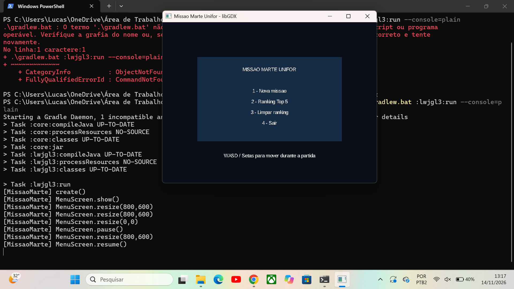
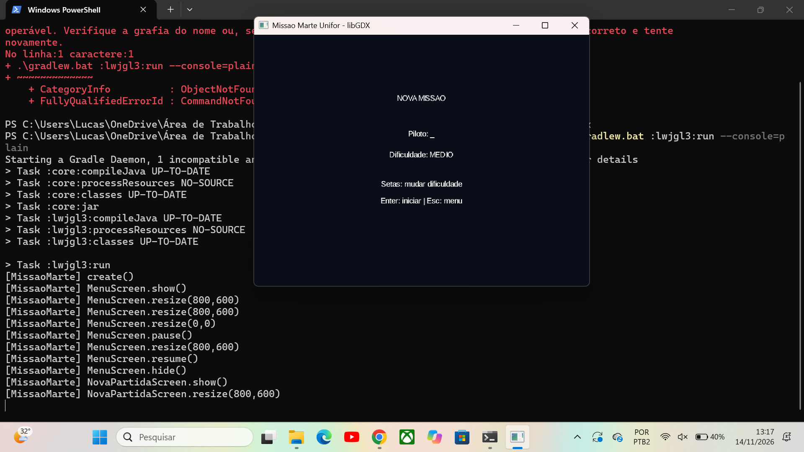
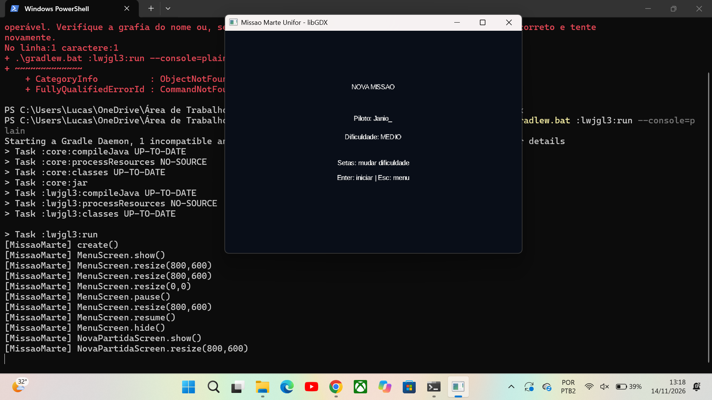
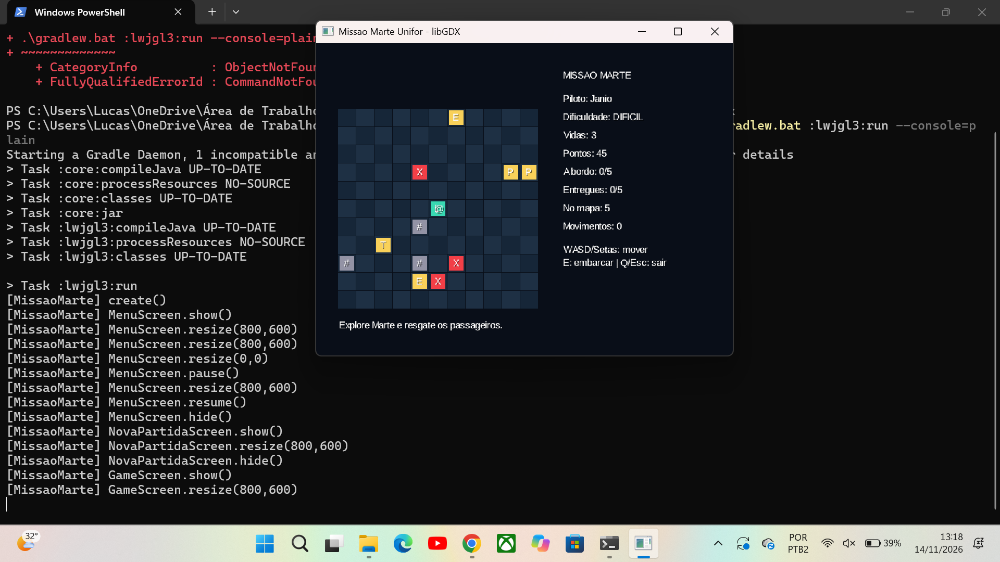
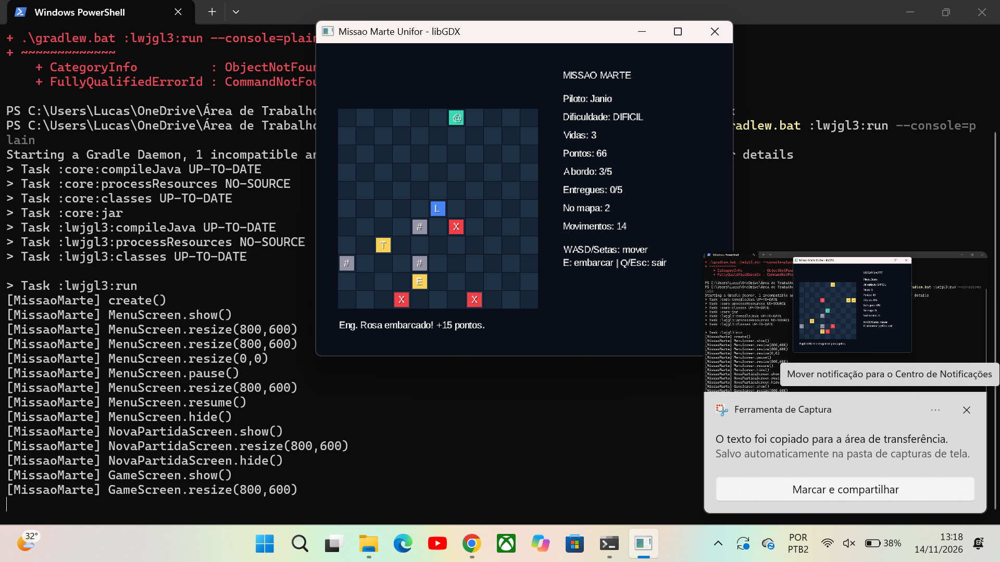
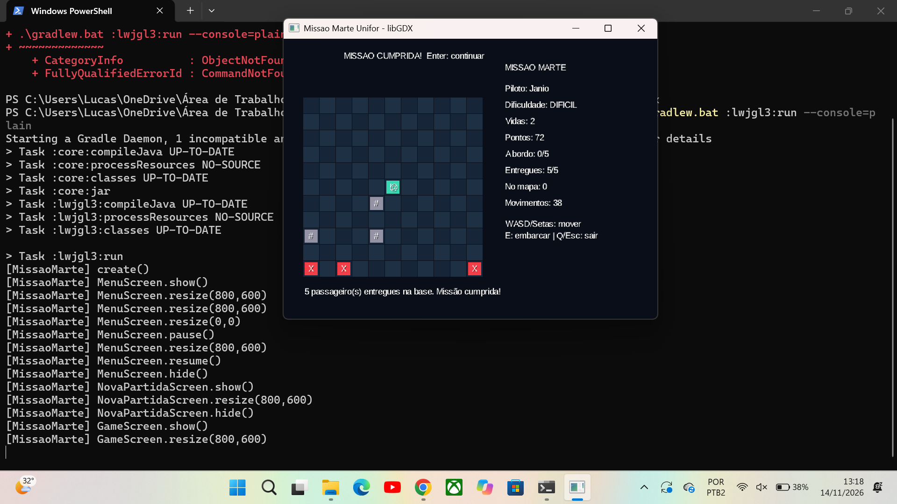
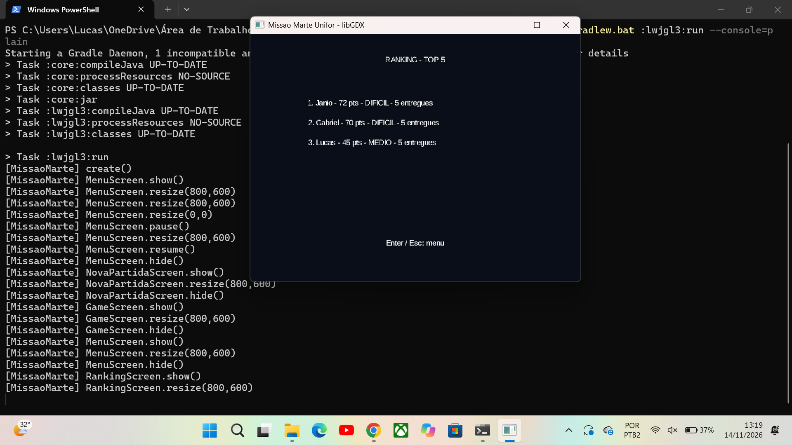
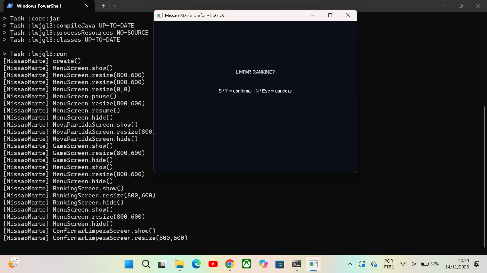
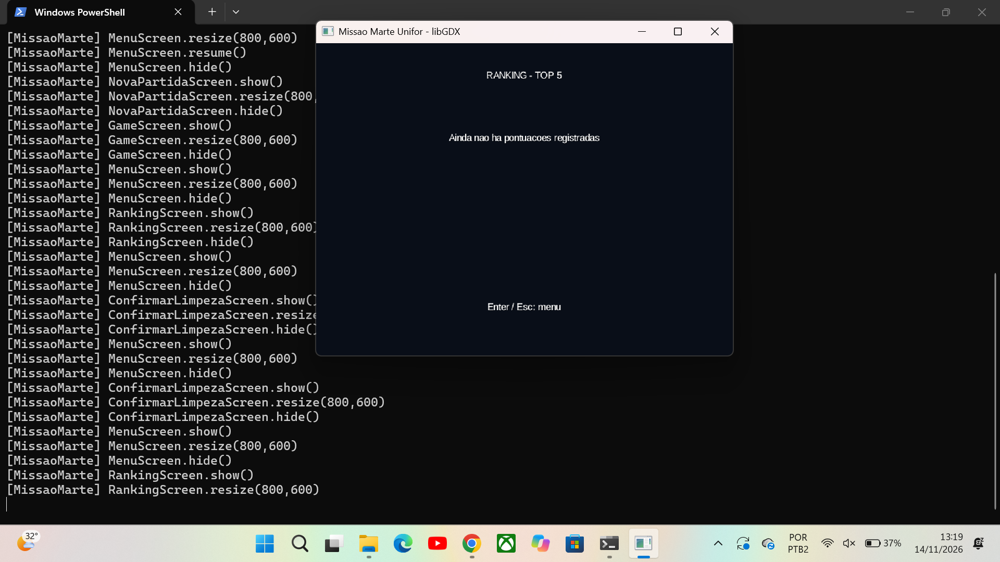

# Evidências de validação — Fase 3 (libGDX)

**Projeto:** Missão Marte Unifor  
**Sprint:** Sprint 2 — Fase 3: Introdução ao libGDX  
**Data da validação visual:** 14/11/2026  
**Ambiente informado:** Windows, Java 17 (Temurin 17.0.21), projeto Gradle multimódulo `core` / `lwjgl3`.

## 1. Objetivo

Documentar a execução da versão gráfica desktop, a navegação entre telas, ações da partida, o fluxo de vitória, o ranking e os eventos de ciclo de vida observáveis no terminal. As evidências foram registradas em capturas da execução local.

## 2. Execução e compilação

O jogo foi iniciado pelo comando:

```powershell
.\gradlew.bat :lwjgl3:run --console=plain
```

As capturas mostram o Gradle executando `:lwjgl3:run`, a janela **Missao Marte Unifor - libGDX** aberta e as mensagens de inicialização `[MissaoMarte] create()`, `MenuScreen.show()` e `MenuScreen.resize(800,600)`.

O responsável pela execução também relatou uma compilação anterior concluída com:

```text
BUILD SUCCESSFUL in 33s
11 actionable tasks: 9 executed, 2 up-to-date
```

**Observação:** esse resultado foi informado pelo responsável, mas não aparece nos dez prints anexados. Uma execução subsequente de `clean build` encontrou um bloqueio da pasta `core/build` pelo Windows/OneDrive, um problema de limpeza de arquivos temporários — não uma falha de compilação Java mostrada nas imagens. Para reforçar a evidência automatizada, anexar futuramente uma captura do relatório `core/build/reports/tests/test/index.html` ou da saída de `gradlew build`.

## 3. Validação funcional ilustrada

| Item | Evidência observada | Resultado |
|---|---|---|
| Menu principal | Quatro opções visíveis: nova missão, ranking Top 5, limpar ranking e sair | Evidenciado visualmente |
| Nova partida | Tela de nome e dificuldade aparece; nome do piloto foi digitado | Evidenciado visualmente |
| Alteração de dificuldade | Tela passa de **MÉDIO** para **DIFÍCIL** | Evidenciado visualmente |
| Início da missão | Grade 11×11, nave, passageiros, perigos, HUD e pontuação inicial exibidos | Evidenciado visualmente |
| Movimentação e resgate | A partida mostra 14 movimentos, 3/5 passageiros a bordo e a mensagem `Eng. Rosa embarcado! +15 pontos.` | Evidenciado visualmente |
| Vitória e entrega na base | Mensagem `MISSÃO CUMPRIDA!`, 5/5 entregues, 0 no mapa, 72 pontos, 2 vidas, 38 movimentos | Evidenciado visualmente |
| Registro de pontuação | Ranking mostra **Janio — 72 pts — DIFÍCIL — 5 entregues** | Evidenciado visualmente |
| Limpeza de ranking | Tela de confirmação de limpeza, seguida de ranking sem pontuações registradas | Evidenciado visualmente |
| Navegação entre telas | Logs `show`, `hide` e `resize` de Menu, NovaPartida, Game, Ranking e ConfirmarLimpeza | Evidenciado nos logs das capturas |
| Pausa e retorno | Logs `MenuScreen.pause()` e `MenuScreen.resume()` são visíveis | Evidenciado nos logs das capturas |

**Escopo da evidência:** não há nestes prints demonstração isolada de *game over*, teste de tecla inválida, colisão com perda de pontos, redimensionamento para tamanhos diferentes, nem do log final `dispose()`. O usuário informou ter testado as funcionalidades, mas essas verificações não devem ser descritas como comprovadas pelas imagens disponíveis.

## 4. Capturas de tela

### 4.1 Menu principal



### 4.2 Tela de nova partida






### 4.3 Partida gráfica e HUD





### 4.4 Vitória e ranking





### 4.5 Limpeza do ranking





## 5. Ciclo de vida libGDX

Os seguintes eventos são **visíveis** nos logs das capturas:

```text
[MissaoMarte] create()
[MissaoMarte] MenuScreen.show()
[MissaoMarte] MenuScreen.resize(800,600)
[MissaoMarte] MenuScreen.resize(800,600)
[MissaoMarte] MenuScreen.resize(0,0)
[MissaoMarte] MenuScreen.pause()
[MissaoMarte] MenuScreen.resize(800,600)
[MissaoMarte] MenuScreen.resume()
[MissaoMarte] MenuScreen.hide()
[MissaoMarte] NovaPartidaScreen.show()
[MissaoMarte] NovaPartidaScreen.resize(800,600)
[MissaoMarte] NovaPartidaScreen.hide()
[MissaoMarte] GameScreen.show()
[MissaoMarte] GameScreen.resize(800,600)
```

Também aparecem eventos de `RankingScreen` e `ConfirmarLimpezaScreen` nas capturas finais. **Não há log de `dispose()` visível** nessas imagens; é uma evidência que pode ser acrescentada após encerrar a aplicação e capturar o terminal.

## 6. Testes automatizados e pontos pendentes

O relato de `BUILD SUCCESSFUL` é um sinal de que a tarefa `build` concluiu naquela execução, mas as capturas não demonstram a **quantidade exata de testes JUnit**. Para documentar esse número, consultar `core/build/reports/tests/test/index.html` e guardar o resultado em uma captura.

Esta documentação também não representa uma comparação por hash dos arquivos copiados da Fase 2; essa comparação deve ser registrada separadamente se exigida na entrega.

## 7. Conclusão

As capturas registram uma execução real da interface desktop libGDX, incluindo menu, cadastro de piloto, seleção de dificuldade, partida por turnos com HUD, resgate, vitória, ranking e limpeza do ranking. Os eventos de navegação, redimensionamento inicial, pausa e retorno estão presentes no terminal. A documentação diferencia os comportamentos comprovados pelos prints das validações que ainda requerem evidência complementar.
