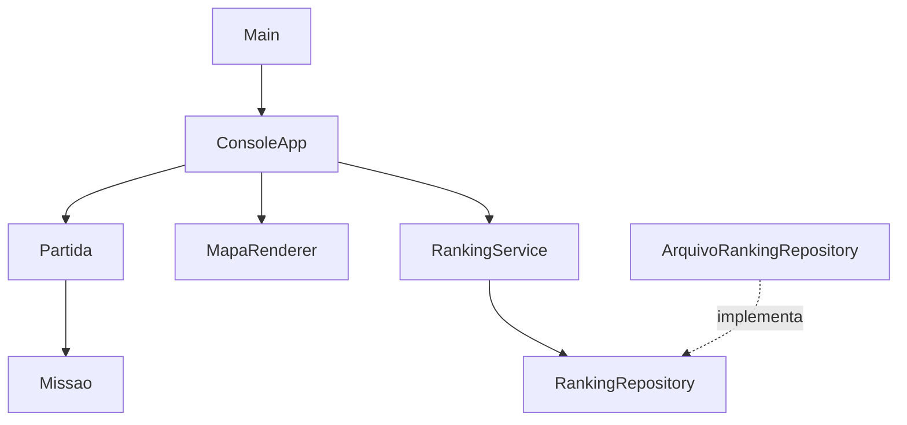
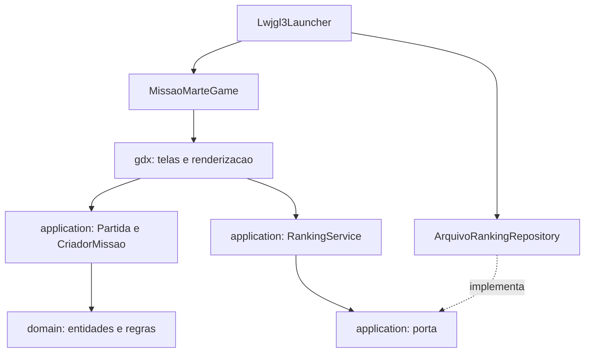

# Fase 3 — Introducao ao libGDX: registro tecnico

## 1. Estado anterior e arquitetura
A Fase 2 recebida e um modulo Gradle com `Main`, `console`, `domain`, `application` e `infrastructure`.
Esta Fase 3 possui `core` (regras e interface compartilhada) e `lwjgl3` (launcher desktop). A Fase 2 nao foi modificada.

| Fase 2 | Fase 3 |
|---|---|
| `Main` | `Lwjgl3Launcher` |
| `ConsoleApp` | `MenuScreen`, `NovaPartidaScreen`, `GameScreen`, `RankingScreen` |
| `MapaRenderer` | `GameScreen` + `MapaGeometria` |
| `Partida.executar(Comando)` | Mesmo arquivo e metodo (nao modificado) |
| `RankingService` Top 5 | Mesmo arquivo e comportamento (nao modificado) |





## 2. Conceitos libGDX aplicados
- `Game`: `MissaoMarteGame.create()` instancia camera ortografica, `FitViewport(800,600)`, `SpriteBatch`, `ShapeRenderer` e `BitmapFont`, e chama `setScreen(new MenuScreen(...))`.
- `Screen`: `TelaBase` registra `show`, `resize`, `pause`, `resume`, `hide` e `dispose` no log. `render` limpa o quadro, aplica viewport e projecao e chama o desenho da tela.
- `Lwjgl3Application` e o backend desktop; cria a janela e invoca os callbacks. O `core` tem apenas a API libGDX.
- `resize` atualiza `FitViewport`, que preserva a proporcao 800:600.
- A aplicacao e por turnos: `InputAdapter.keyDown` converte eventos em `Comando` e chama `Partida.executar`, enquanto `render` apenas le o estado e redesenha. Teclas invalidas nao consomem turno.
- `MissaoMarteGame.dispose()` libera `SpriteBatch`, `ShapeRenderer` e `BitmapFont`. As telas nao possuem recursos graficos proprios. Cada tela instala o processador em `show()` e o remove em `hide()`.
- `Game.setScreen` usa estados/telas; `TelaBase.render` centraliza a sequencia de desenho (Template Method); `TecladoParaComando` e um adaptador da API de entrada; `MapaGeometria` e Pure Fabrication, isolando Y invertido.

## 3. Decisoes e divergencias importantes
O enunciado menciona uma Fase 2 *diferente* do ZIP recebido: `GameSession`, `Acao`, `RankingEntry` em `infrastructure`, ranking Top 10, 28 testes e pacote `br.edu.unifor.missaomarte`. **Nada disso corresponde ao ZIP real**: aqui ja existem `Partida`, `Comando`, `RankingEntry` e `RankingRepository` em `application`, Top **5**, pacote `missaomarte` e **um metodo JUnit** com multiplas verificacoes. Alterar o ranking para Top 10, trocar a API ou reescrever regras nesta fase contrariaria a preservacao da Fase 2. Portanto foram mantidos.

`domain`, `application` e `infrastructure` foram copiados sem alteracoes. Os testes herdados foram adaptados removendo apenas a dependencia da interface console, que nao faz parte da Fase 3. Testes novos cobrem teclado, geometria e ranking em memoria.

A configuracao do Gradle Wrapper foi alterada de 8.14.3 para **8.7**, conforme o enunciado. A fonte do JUnit foi mantida em 5.11.4, que ja era usada na Fase 2. O Java de compilacao e 17. Textos visuais simplificados evitam problemas de encoding em terminais.

## 4. Passo a passo
1. Copiar as classes sem dependencia grafica para `core` e remover `Main` e `console`.
2. Criar projeto Gradle multi-modulo e configurar `lwjgl3` para executar na raiz da fase.
3. Construir `MissaoMarteGame` e compartilhar recursos graficos.
4. Implementar menu, entrada do nome/dificuldade, partida e ranking.
5. Adaptar codigo de teclado em `TecladoParaComando` e a geometria em `MapaGeometria`.
6. Adicionar testes JUnit sem OpenGL.

## 5. Validacao e evidencias
**Ainda nao foram executados `gradlew clean build` nem a janela desktop nesta sessao de criacao**. O ambiente local nao disponibiliza as dependencias libGDX em cache nem o Gradle 8.7 para comprovacao. A compilacao Java pura das camadas sem libGDX pode ser verificada separadamente. Nao declarar testes graficos como aprovados ate executa-los no Windows.

No Windows (JDK 17 e internet):
```powershell
.\gradlew.bat --version
.\gradlew.bat clean build
.\gradlew.bat :lwjgl3:run --console=plain
```

Roteiro manual: menu 1-4; limpar ranking (confirmar com S); digitar nome, Backspace e setas de dificuldade; `W` move para cima; tecla irrelevante nao avanca turno; embarcar com E; entregar na base; colisao diminui vida e pontos; registrar vitoria uma vez e consultar ranking; derrota; redimensionar; minimizar e restaurar; fechar janela e consultar logs; verificar `ranking.json` na raiz.

**Observacao:** o exemplo de log do professor nao foi copiado como evidência real. Cole aqui a saida verdadeira do seu computador apos validar, incluindo `create`, `show`, `resize`, `pause`, `resume`, `hide`, `dispose`.

## 6. Limitacoes e proxima fase
1. As formas coloridas ainda nao sao sprites. Na Fase 4 implementar texturas e animacoes.
2. Nao ha audio; na Fase 4 utilizar `Sound` e `Music` com descarte explicito.
3. O HUD e textual, sem barras, icones ou transicoes; melhorar na Fase 4.
4. `GameScreen` concentra desenho e geracao de HUD; extrair renderizadores menores na Fase 4.
5. A configuracao de ranking Top 5 difere do enunciado Top 10; alterar apenas com autorizacao do professor, e documentar diferenca funcional.

## 7. SHA-256 dos arquivos de dominio originais
As copias em `core` usam os mesmos bytes e foram copiadas sem editar.

| Arquivo `domain` | SHA-256 |
|---|---|
| Asteroide.java | `b803fb26f8f5d8ea1b4d20edb167ab816118aab9d8bb28266e5d99975c2620f7` |
| Astronauta.java | `a5db57d528552a53b2f233d0bd5e57c51c4d5b1529943ce1b2ce1dc7b6cb936b` |
| Base.java | `1f21b18e9bbad35847d60452cd063eb62d486c24893a07fbf7d7767dfba9932e` |
| Dificuldade.java | `e49e3e0406bc2789b54db73ef7ef2fdfbeb60dfa4c23794d35525f5342e7203e` |
| Engenheiro.java | `f1ca23349b2a1c6e8ed498c7515f866b534efa9afca14d903b9448f92444e51f` |
| EntidadeFixa.java | `0a3ec0a9cebd89d476f471f57c8fb8a4870033c0352b96cff2e68c3b435ef604` |
| EntidadeMapa.java | `6b1937164e856c430a061da286008f817b709551062a9a4cdc812b14bf323cf3` |
| Inimigo.java | `3e476702c8e05d2b87c0e1cb58aca2813c62f65077fbac6a771f4f98dd0c8f36` |
| Missao.java | `4ba1e8e4d185aec0bb64b34be909620226a604bbf30500773b4cacba2b00159f` |
| Nave.java | `1ea2afdc68a94175fa3aedab64b33e688d18abc301e8267c8cb0971237af3f07` |
| Passageiro.java | `fb88a0898f377b0a8f80f2d1e5c529a2e243b40c6fcf02932d6915f2d99c9951` |
| Posicao.java | `17f7521083257a7f854f1516174c4dab7e5ff35d980ef22717fdbe03fd0e02b7` |
| Professor.java | `c97a0781fa87597556b6b3cb35874cae9b95d5004bcdf04a882515911e1fe50d` |
