# Evidências de testes da Fase 4

Missão Marte UNIFOR · Versão desktop com libGDX · 17 de novembro de 2026

As capturas foram registradas por Lucas Fidelis no Windows, em uma execução pelo Windows PowerShell 5.1. Elas documentam a compilação, a abertura do jogo, o início nas três dificuldades, a vitória no Médio e o fluxo de consulta e limpeza do ranking.

## Compilação e execução

Na pasta `fase-04-interface-grafica`, os comandos para reproduzir a execução são:

```powershell
.\gradlew.bat clean build
.\gradlew.bat :lwjgl3:run --console=plain
```

### 1. Build e testes automatizados

O PowerShell registra `BUILD SUCCESSFUL in 20s`. Entre os testes aprovados aparece `RankingServiceTest > naoSubstituiEmpateNoUltimo()`, que verifica o empate na última posição do Top 5.

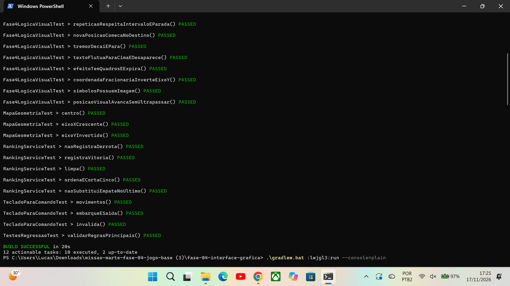

### 2. Execução e encerramento no Windows

O comando `.\gradlew.bat :lwjgl3:run --console=plain` abre o aplicativo. O log registra 21 imagens e 8 sons carregados, abertura das telas, redimensionamento e encerramento com `BUILD SUCCESSFUL`.

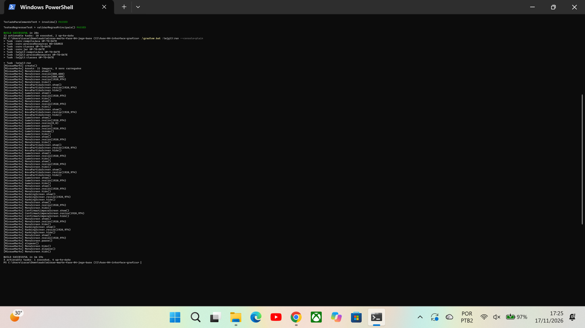

## Testes manuais

### 3. Menu principal

O menu mostra a nave, o fundo estrelado e as opções de iniciar uma missão, consultar ou limpar o ranking e sair.

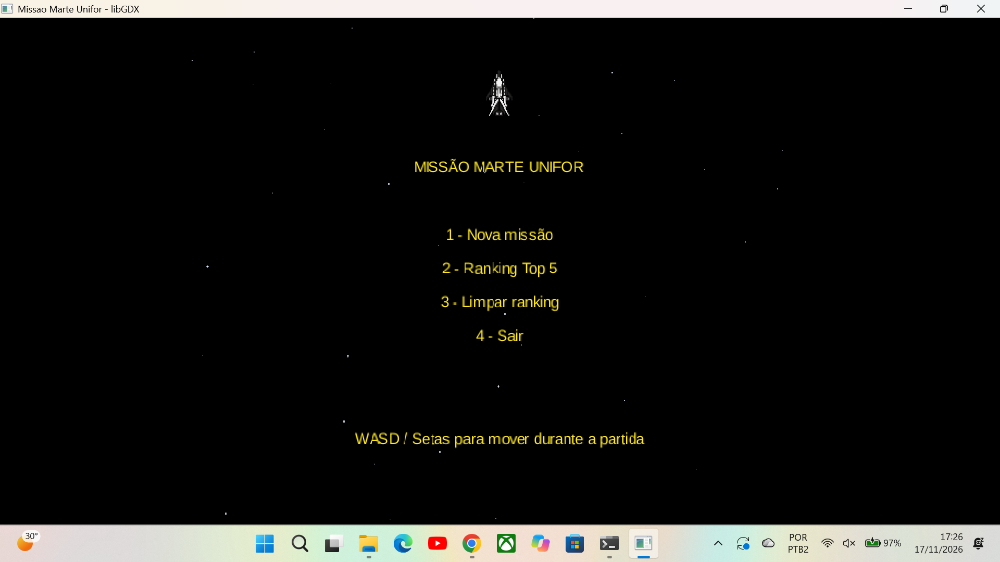

### 4. Configuração da nova missão

A tela mostra o nome digitado do piloto, a dificuldade Média selecionada e os comandos de confirmação e retorno.

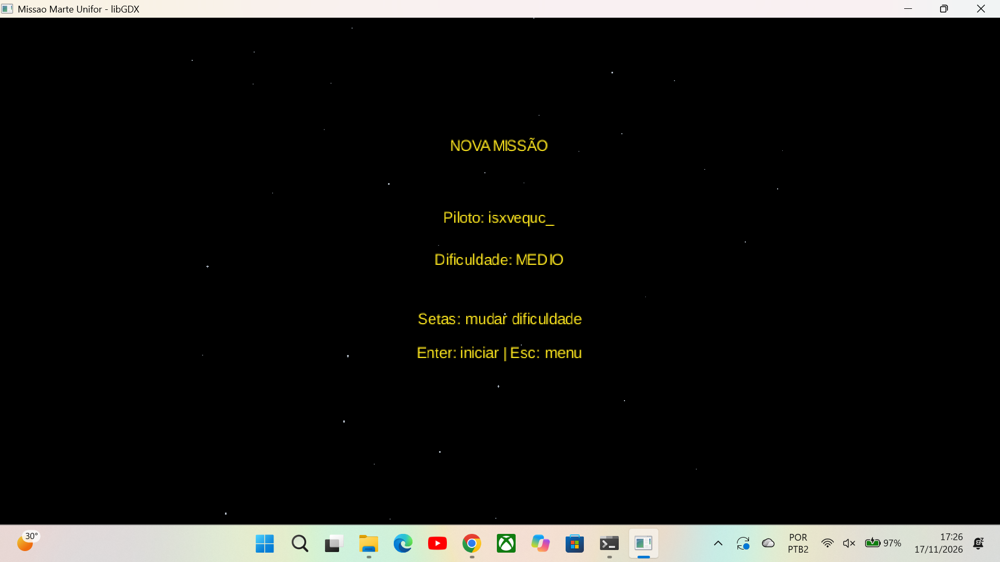

### 5. Início no Fácil

A nave começa na base com 30 pontos, 10 passageiros no mapa, 2 inimigos e 2 asteroides. O HUD marca 0 de 10 entregues e 0 movimentos.

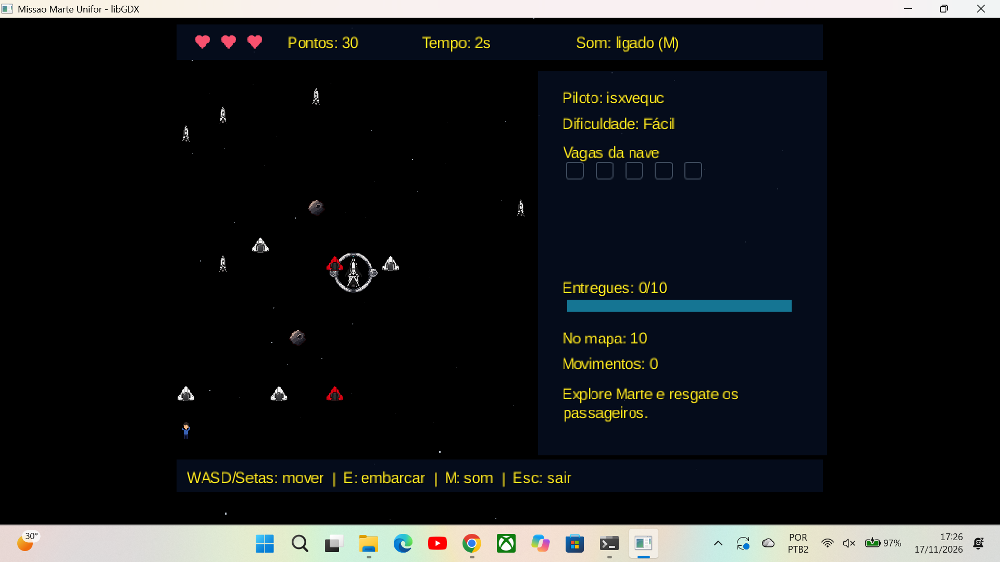

### 6. Início no Médio

A nave começa na base com 20 pontos, 10 passageiros no mapa, 4 inimigos e 4 asteroides. A área jogável aparece por completo ao lado do HUD.

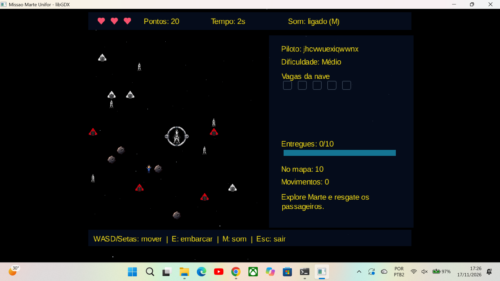

### 7. Início no Difícil

A nave começa na base com 45 pontos, 10 passageiros no mapa, 8 inimigos e 8 asteroides. A captura foi feita aos 7 segundos, com 0 movimentos.

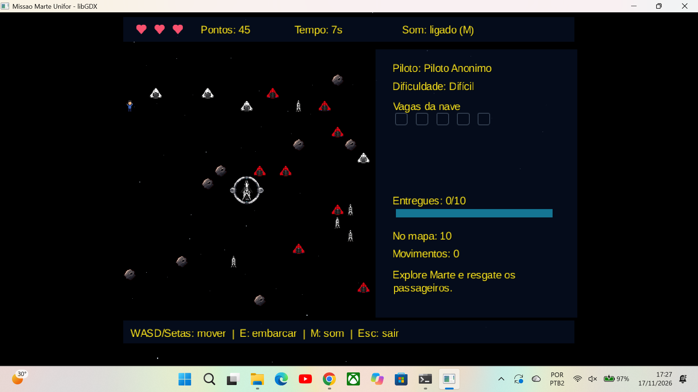

### 8. Vitória no Médio

O HUD registra a missão cumprida com 10 de 10 passageiros entregues, 79 pontos, 131 movimentos e 32 segundos. O mapa mostra zero passageiros restantes.

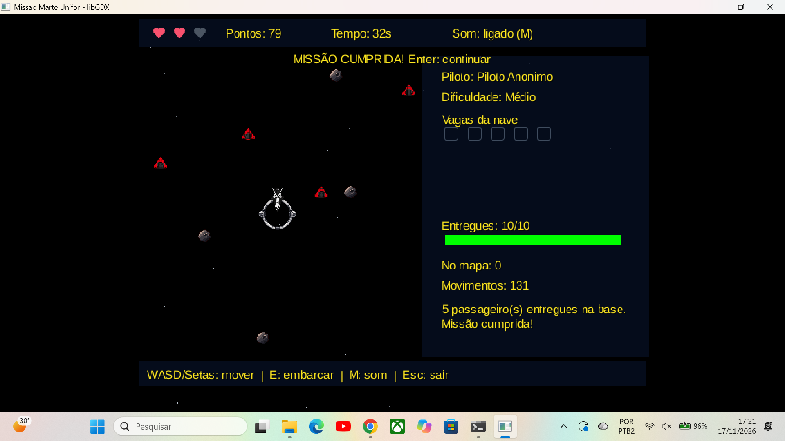

### 9. Consulta ao ranking

O Top 5 exibe um registro de 105 pontos no Médio, com 10 passageiros entregues. O registro corresponde a uma partida diferente da vitória de 79 pontos.

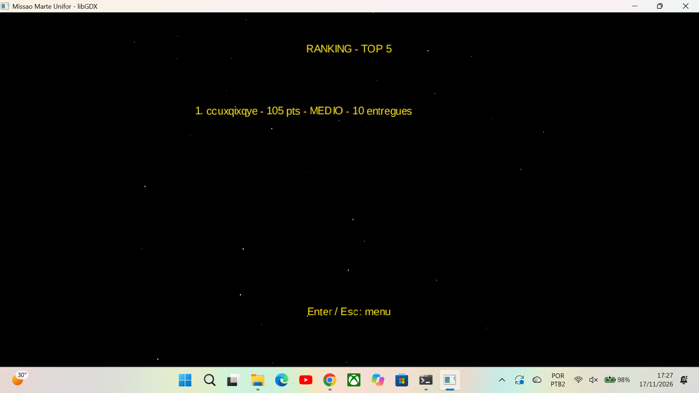

### 10. Solicitação de confirmação

A tela oferece as opções de confirmar ou cancelar antes de limpar o ranking.

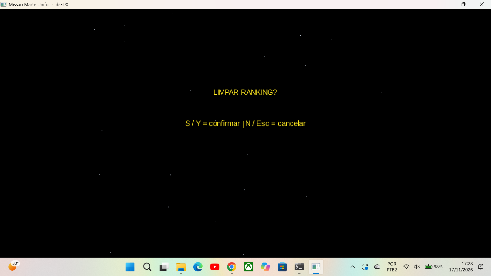

### 11. Confirmação da limpeza

Depois da confirmação, a interface exibe a mensagem “Ranking limpo!”.

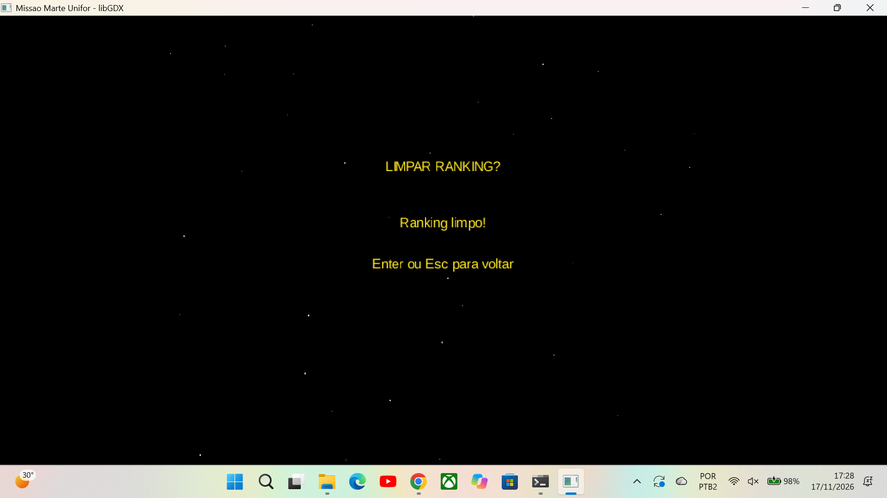

### 12. Ranking após a limpeza

Ao reabrir o Top 5, a interface informa que não há pontuações registradas.

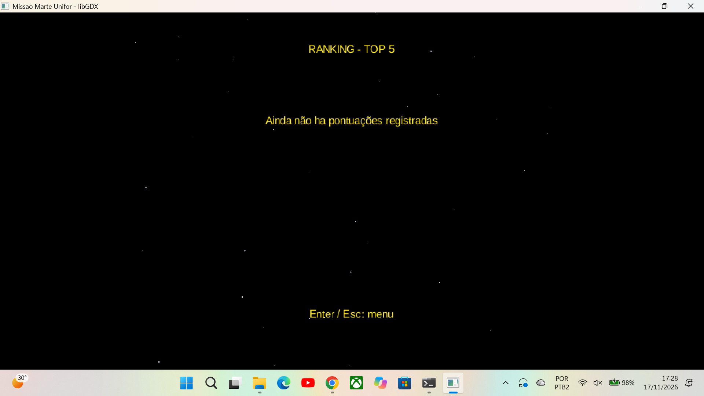

## Alcance das evidências

As imagens registram os estados das telas e os resultados exibidos. A patrulha em movimento, as variações da chama, a reprodução audível dos efeitos e o instante da colisão exigem observação direta ou vídeo. As capturas fornecidas mostram uma vitória, a entrega final e o registro no ranking.
