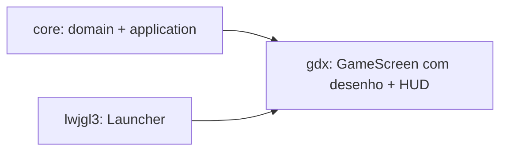
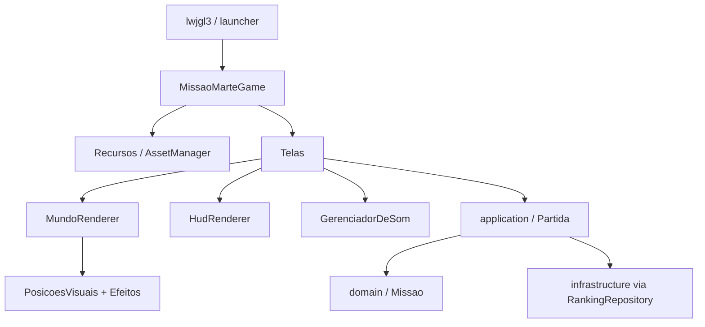

# Tutorial — Fase 04: Interface gráfica do Missão Marte

## 1. Origem e destino

Na Fase 3 o mapa era desenhado com retângulos e símbolos em `GameScreen`. Na Fase 4, há um catálogo de arquivos PNG/WAV, `AssetManager`, renderizador do mapa, visualização interpolada, eventos do turno e HUD. O jogo permanece **por turnos**.

| Fase 3 | Fase 4 |
| --- | --- |
| Retângulos coloridos | Imagens PNG / `TextureRegion` |
| Símbolos desenhados como caracteres | `SimboloParaImagem` seleciona sprites |
| Mensagens do `ResultadoTurno` | Mensagens + `List<EventoTurno>` |
| Movimento instantâneo mostrado de uma vez | `PosicaoVisual` interpola sem alterar a lógica |
| Painel textual em `GameScreen` | `HudRenderer` separado |
| Sem áudio | `GerenciadorDeSom` + `Sound`/`Music` |

## 2. Arquitetura

Antes:



Depois:



**Dependência:** `domain`, `application` e `infrastructure` não importam `com.badlogic.gdx`. Os recursos de vídeo e som só aparecem no pacote `gdx` e no launcher.

## 3. Recursos e renderização

- `Imagem` e `Som` são enums puros com caminho, dimensões, quadros e tipo do recurso.
- `Recursos.carregar()` chama `AssetManager.load()`, depois `finishLoading()` e finalmente organiza `TextureRegion` para cada faixa horizontal de quadros.
- `Texture` representa os pixels na GPU; `TextureRegion` é uma região da textura; `Animation<TextureRegion>` seleciona os quadros pelo tempo visual.
- `Recursos.dispose()` libera o `AssetManager` uma vez; `MissaoMarteGame.dispose()` libera também `SpriteBatch`, `ShapeRenderer` e `BitmapFont`.
- PNG e WAV são gerados pelo programa Java em `tools` e versionados. Os créditos estão em `docs/creditos.md`.
- O launcher inclui `core/assets` nos recursos do módulo `lwjgl3`.

## 4. Separação da lógica de jogo

`Partida.executar(Comando)` continua calculando movimentos, embarque, entrega, colisões, pontos e vitória. O novo enum `EventoTurno` registra fatos **já decididos**; a tela reage a eles com sons, brilho, explosão e textos. O construtor antigo de `ResultadoTurno` continua disponível.

A duração usa `fim` congelado na vitória, derrota ou aborto; isso evita que o tempo no ranking mude após terminar. Os objetos do domínio não conhecem `Texture`, `Sprite` nem áudio. Sprites são selecionados a partir de `EntidadeMapa.getSimbolo()`, sem inspeção do tipo (`instanceof`) para escolher a imagem.

## 5. Interpolação, entrada e colisão

`PosicaoVisual` mantém coordenadas fracionárias que se aproximam do destino em 12 células por segundo sem ultrapassá-lo. `PosicoesVisuais` mapeia entidades por **identidade**, inicializa objetos novos na posição real e remove objetos desaparecidos. `MapaGeometria` transforma essas coordenadas no espaço gráfico e inverte Y.

`RepetidorDeTecla` espera 0,28 s antes de começar repetições com intervalo de 0,14 s. Cada repetição chama `Partida.executar`, portanto consome um turno completo. Comandos inválidos não consomem turno.

A colisão é determinada no domínio por igualdade de célula: **não usamos `Intersector`**. Ao receber `COLISAO`, a apresentação reproduz explosão, flash, tremor, texto e som; não calcula uma segunda colisão com hitboxes.

## 6. HUD e som

`HudRenderer` apenas consulta a `Partida`. A barra superior mostra vidas, pontos, duração e estado do som; o painel à direita mostra piloto, dificuldade, vagas, entregas, passageiros restantes, movimentos e mensagem; o rodapé mostra controles. `ShapeRenderer` e `SpriteBatch` são usados em lotes separados; painéis semitransparentes habilitam `GL_BLEND`.

`GerenciadorDeSom` não é dono dos arquivos: toca efeitos `Sound`, controla uma `Music` em laço e alterna o mudo. A tecla `M` é instalada em `TelaBase`, exceto em `NovaPartidaScreen`, onde a letra é parte do nome. `-Dmissaomarte.semaudio=true` desativa o carregamento de áudio no launcher.

## 7. Padrões e decisões

- **Facade:** `Recursos` centraliza o uso do `AssetManager`.
- **Eventos de domínio simplificados:** `EventoTurno` comunica resultados sem vincular regras ao desenho.
- **Template Method:** `TelaBase.render()` organiza limpeza, projeção, fundo e desenho.
- **Pure Fabrication / GRASP:** `PosicaoVisual`, `Tremor`, `RepetidorDeTecla` e `MensagensFlutuantes` existem para separar responsabilidades e facilitar testes.
- **Injeção de dependência manual:** launcher cria fábrica, ranking e gerador aleatório.
- **Observer:** entrada por `InputProcessor` é do libGDX; a reação da tela aos eventos é direta e não implementa registro de ouvintes.

## 8. Arquivos preservados e alterações

O domínio foi copiado da Fase 3 sem mudanças. Em aplicação foram modificados **`Partida.java` e `ResultadoTurno.java`** e criado `EventoTurno.java`. As regras permanecem as da Fase 3; a alteração do tempo foi incluída para o resumo da partida ficar estável.

A documentação do professor emprega classes `GameSession` e `Acao`, mas o projeto concreto usa `Partida` e `Comando`; manteve-se a nomenclatura existente.

## 9. Validação e evidências

Executar no Windows:

```powershell
.\gradlew.bat --version
.\gradlew.bat clean build
.\gradlew.bat :lwjgl3:run --console=plain
.\gradlew.bat :lwjgl3:run -Dmissaomarte.semente=4 --console=plain
.\gradlew.bat :lwjgl3:run -Dmissaomarte.semaudio=true --console=plain
```

Os testes novos em `Fase4LogicaVisualTest`, `Fase4AssetsTest` e `Fase4EventosTest` verificam, respectivamente, matemática de movimento/efeitos, formatos dos assets e compatibilidade/eventos da aplicação sem criar janelas. A execução dos testes JUnit precisa ser registrada em `docs/evidencias.md` após o build real.

**Limitação desta preparação:** a distribuição Gradle não pôde ser baixada no ambiente de montagem, portanto a compilação integral e o teste visual/sonoro não foram executados. A compilação isolada de `domain`, `application`, `infrastructure` e classes puras de visual foi realizada com sucesso. Não inventar contagem de testes ou logs.

## 10. Limitações e próximos passos

1. Arte e áudio procedurais simples; podem ser substituídos por recursos licenciados com créditos.
2. Fonte `BitmapFont` padrão pode perder nitidez ao ampliar; pode ser substituída por uma fonte bitmap própria.
3. Mensagens herdadas da aplicação nem sempre são acentuadas; internacionalização fica para evolução futura.
4. Não há tela de carregamento; `finishLoading()` bloqueia brevemente a inicialização.
5. Servidor de ranking e autenticação são da Fase 5; Android e toque são da Fase 6.
