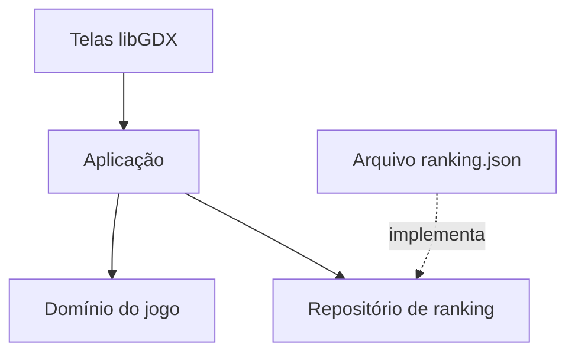
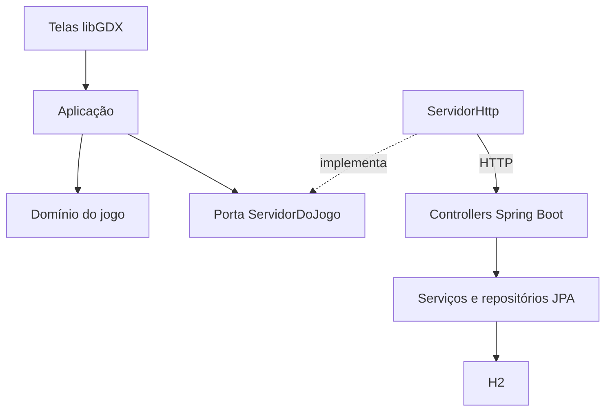

# Tutorial da Fase 05

## 1. Da partida local à conta

Na Fase 4, o cliente desktop conduzia a partida e registrava apenas vitórias no ranking da máquina. A Fase 5 mantém esse fluxo para convidados e acrescenta o fluxo com conta.

| Função | Fase 4 e convidado | Com conta na Fase 5 |
| --- | --- | --- |
| Identidade | Nome digitado na criação da missão | Nome da conta autenticada |
| Histórico | Sem histórico remoto | Vitória e derrota registradas no H2 |
| Classificação | Top 5 local em `ranking.json` | Top 10 global, uma vitória por jogador |
| Consulta | Leitura síncrona local | HTTP assíncrono |

**Fase 4**

**Fase 5**

O jogo continua jogável sem login por decisão de produto, conforme a divergência registrada no planejamento em relação ao `PROMPT_MESTRE`.

## 2. Contrato HTTP e persistência

A API REST expõe recursos por caminho. `POST` cadastra um jogador, autentica ou grava uma partida, conforme a rota. `GET` lê os registros. Os códigos `200` e `201` indicam resposta bem-sucedida e recurso criado. `400` indica entrada inválida, `401` credenciais ou token inválidos e `409` conflito de nome. A API usa `ProblemDetail` para os erros e acrescenta `campos` para validações de formulário.

Os controllers recebem e devolvem DTOs, records como `Credenciais` e `Partida.Registro`. Os serviços tratam cadastro, autenticação e gravação. Os repositórios JPA consultam e persistem as entidades. A restrição única no nome normalizado resolve cadastros com caixa diferente e concorrência. O banco H2 em arquivo preserva os dados entre execuções. `ddl-auto=update` atende ao ambiente do exercício. Uma implantação deve aplicar migrações com histórico, revisão e controle de versão.

A consulta `melhoresVitorias` seleciona vitórias positivas para as quais não existe uma vitória melhor do mesmo usuário. Ordena por pontuação decrescente, duração crescente e data mais antiga. O ID estabiliza o empate de registros com o mesmo instante. A consulta retorna 10 posições. O histórico tem página de índice zero, tamanho de 1 a 50 e ordenação da partida mais recente para a mais antiga. O UUID de envio repetido recupera a partida já registrada para a mesma conta.

## 3. Conta, validação e segurança

O BCrypt usa um sal aleatório por senha e custo 10. O servidor verifica a senha recomputando o hash. Criptografia reversível permitiria recuperar as senhas com a chave. A validação mede a senha em UTF-8, com máximo de 72 bytes para evitar truncamento. Argon2id é uma alternativa preferida pela OWASP para sistemas novos por também exigir memória durante o cálculo.

O login verifica um hash falso quando o nome não existe. A mensagem para nome inexistente e senha errada é a mesma. O JWT assinado contém ID do usuário em `sub`, nome, instante de emissão e expiração em duas horas. O servidor obtém o ID do token ao registrar um resultado. Um token roubado concede acesso até expirar. O cliente mantém a sessão em memória, e a API autentica cada chamada pelo cabeçalho Bearer. Como o navegador não anexa automaticamente uma credencial em cookie, o mecanismo de CSRF para autenticação por sessão fica desativado.

O segredo vem de `MISSAOMARTE_JWT_SEGREDO`. Sem esse valor, a reinicialização invalida as sessões anteriores. O cliente valida o formulário para dar feedback imediato, e o servidor valida novamente porque qualquer pessoa pode chamar a API diretamente. Senhas, tokens e hashes ficam fora dos logs e respostas comuns. Apenas o login retorna o token.

## 4. Cliente e dependências

`ServidorDoJogo` é a porta de aplicação, com callbacks independentes do libGDX. `ServidorHttp` implementa a porta usando `Gdx.net.sendHttpRequest`. `JsonDaApi` serializa os dados com `JsonWriter` e interpreta os DTOs e erros com `JsonReader`. O adaptador entrega cada resposta por `Gdx.app.postRunnable` para que só a thread de renderização atualize o estado das telas. Enquanto a rede trabalha, o cliente continua renderizando.

O launcher injeta o adaptador e configura a URL. O menu seleciona o fluxo a partir da sessão. `NovaPartidaScreen` usa o nome da conta quando disponível. `GameScreen` decide qual destino recebe o resultado. O ranking local continua usando o repositório de arquivo da Fase 4. As telas online exibem estados de carregamento, sucesso e falha. A resposta 401 em uma rota protegida descarta a sessão e retorna ao menu convidado.

Os dois wrappers são independentes porque o Spring Boot 4.1 exige Gradle 8.14 ou superior e o cliente preserva o wrapper 8.7 da Fase 4. A dificuldade tem um enum em cada projeto para que o servidor valide o valor recebido sem depender do domínio do cliente.

## 5. Montagem e teste

1. Copiar a Fase 4 para `cliente/` e comparar os hashes do domínio.
2. Montar o servidor com persistência, validação e autenticação. Testar as chamadas por `requests.http` ou Swagger UI.
3. Adicionar porta, adaptador e telas. Validar o fluxo de convidado e de conta conforme o [roteiro](validacao.md).
4. Rodar os comandos dos dois projetos conforme o [README](../README.md). A validação usou dependências baixadas à parte para contornar a indisponibilidade da rede do Gradle neste ambiente. No servidor, o Jackson 3 exigiu as chaves de configuração específicas para enum e data, e o tratador de erros da API ganhou precedência sobre o tratador padrão para incluir os campos inválidos. O roteiro registra os resultados observados e os testes de interface a executar no Windows.

## 6. Limitações e passos futuros

- O servidor não simula a partida. Validação de formato e faixas não comprova a legitimidade da pontuação. Uma fase futura pode validar uma repetição gravada ou fazer a simulação no servidor.
- O HTTP padrão é local e sem TLS. Na integração em rede ou no Android, configure HTTPS e a permissão de Internet antes de enviar credenciais.
- Não há renovação nem revogação de tokens, controle de tentativas de login ou fila offline. A Fase 6 ou 7 pode tratar esses cenários. Na versão atual, `R` reenvia enquanto a tela de resultado estiver aberta.
- O Top 10 é único para todas as dificuldades.
